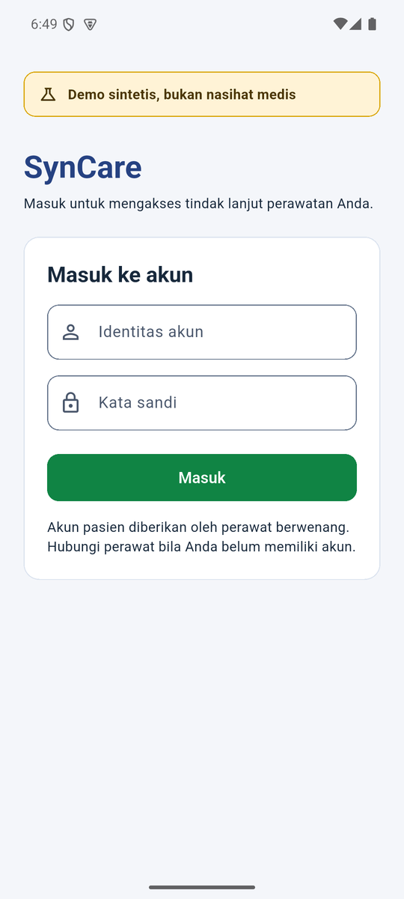
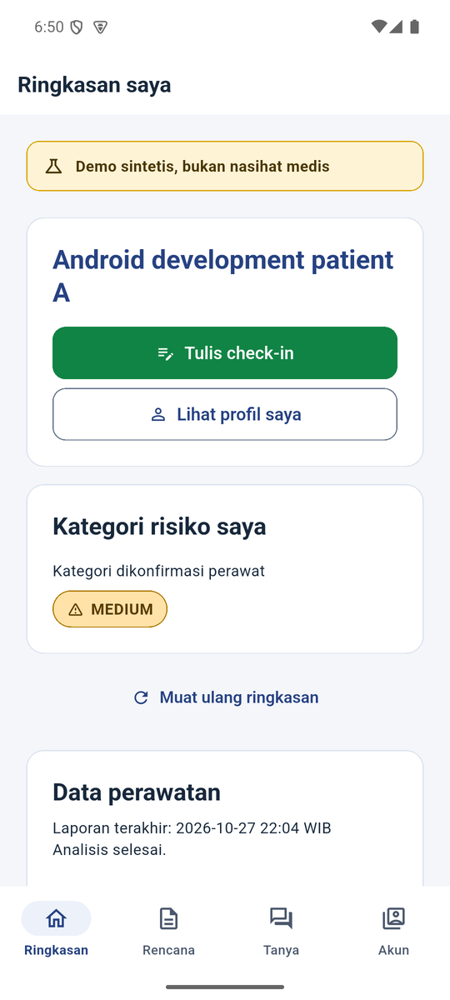
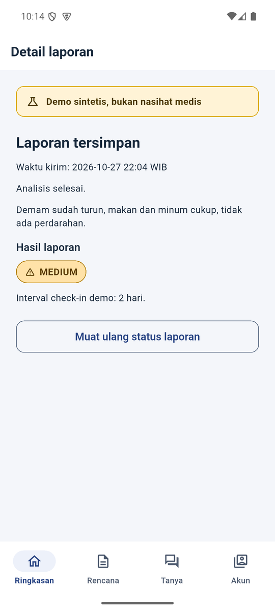
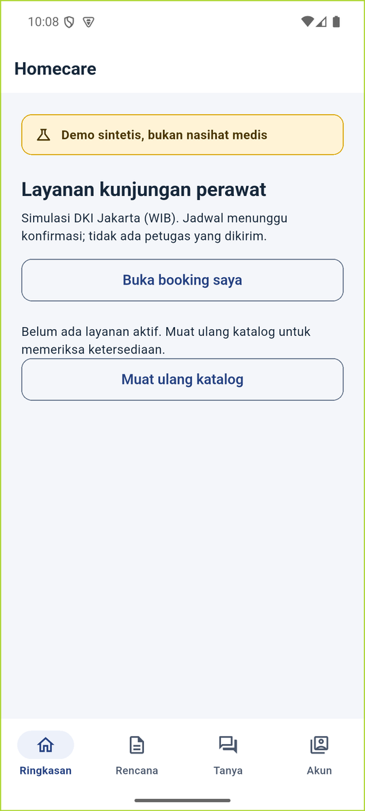
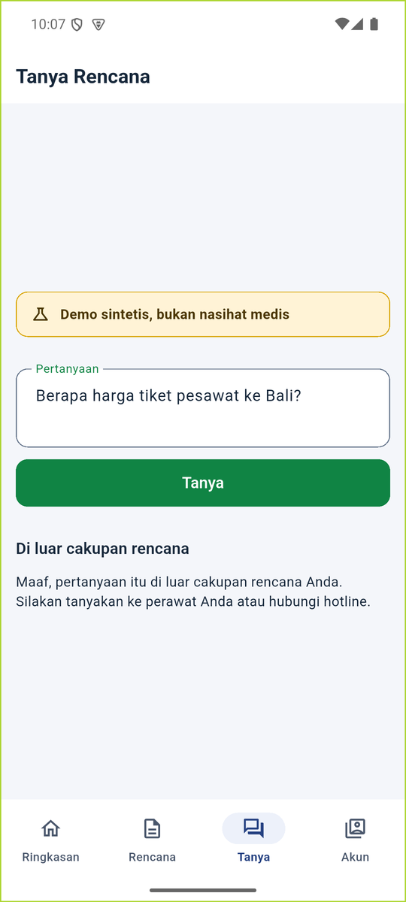
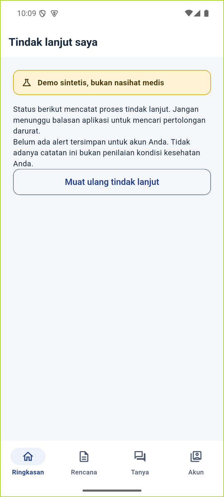

# SynCare mobile

SynCare is a Flutter client for a synthetic, risk-adaptive post-discharge follow-up service for
patients with congestive heart failure (CHF). The patient app is the primary experience: sign in,
review the confirmed care summary and approved plan, submit check-ins, ask questions grounded in
that plan, and manage homecare requests.

Clinical decisions belong to the SynCare service; the backend delegates them to its Langflow flows.
The client renders risk scores, tiers, red flags, plan content, approvals, and answers exactly as
the API returns them. It does not diagnose, tier, prescribe, draft, or approve on its own.

> **Synthetic demo, not medical advice.** This app is not a medical device and is not clinically
> validated. It does not provide diagnosis, medication changes, emergency dispatch, or a substitute
> for professional care.

## Current UI

<p align="center">
  
  
  
</p>
<p align="center"><sub>Sign in · Summary · Approved plan</sub></p>

<p align="center">
  
  
  
</p>
<p align="center"><sub>Check-in detail · Grounded answer · Homecare</sub></p>

<p align="center">
  
  
</p>
<p align="center"><sub>Refusal kept verbatim · Follow-up status</sub></p>

Only `04-patient-plan.webp`, `08-patient-ask-answer.webp`, and `22-*` through `32-*` reflect the
current UI. The remaining files in `docs/screenshots/` are legacy captures, including the old role
picker and earlier nurse screens; do not use them as a reference for the current app.

## What patients can do

- **Sign in with a care-team account.** The backend validates the identifier and password and
  returns the account role and, for patients, the linked patient ID. A stored session is checked
  again on launch. Invalid or expired sessions return to sign-in.
- **See a confirmed summary.** `Ringkasan saya` shows the patient's display name, the risk category
  confirmed by a nurse, the latest report state, and a prominent notice when the latest check-in was
  urgent.
- **Submit a check-in.** The patient writes a free-text report. The app distinguishes a saved
  receipt from server-side analysis, can retry the same submission after an uncertain delivery, and
  keeps a paginated history with detail for each report.
- **Read the approved plan.** `Rencana Saya` shows verified care plans, the approval time, care
  instructions, risk level, follow-up information, and earlier approval versions. If the plan came
  from a previous discharge source, the app says so. A missing plan is an empty state, not an error.
- **Ask about the plan.** `Tanya Rencana` sends a question and renders the answer with numbered
  sources, marking whether each source is an approved care plan or general education material.
  Refusals are shown verbatim. An urgent answer shows the emergency notice and supplied guidance
  without claiming that help was dispatched.
- **Request homecare.** The catalog covers synthetic DKI Jakarta services with WIB visit windows.
  A request requires an address, kelurahan, kecamatan, city, and preferred date/time. Patients can
  follow their own bookings, open the detail and timeline, and cancel a `Requested` or
  `Under Review` booking with a reason. A preferred window is never presented as a confirmed visit.
- **Follow up on an escalation.** `Tindak lanjut saya` lists the patient's own follow-up records and
  opens a detail view with acknowledgment and status history. An empty list is explained as an
  absence of records, not as a health assessment.
- **View a read-only profile and sign out.** `Profil saya` is read-only. Logout clears the local
  session and asks the backend to revoke it.

The Flutter client also retains the original nurse screens under `/nurse/*` for the clinician
workflow. They are role-guarded. A nurse sign-in lands on the account screen, which points to the
separate nurse dashboard; the patient navigation does not expose these screens.

## How it works

The app is a thin, typed client over the SynCare HTTP API. The signed-in patient's identity always
comes from the validated session, not from a build flag or a locally selected patient. A `401`
ends the local session and returns to sign-in. Deep links to `/patient/*` require a patient session
and `/nurse/*` requires a nurse session; a signed-in account with the wrong role is redirected to
the account screen.

| Concern | Implementation |
|---|---|
| UI | Flutter, Material 3, Indonesian-language interface |
| State | `flutter_riverpod` 2.6 |
| Routing | `go_router` 17 with role-aware redirects |
| REST | `dio` 5 with a bearer-token interceptor |
| Streaming | `http.Client().send()` and a chunk-safe SSE parser for the retained nurse approval desk |
| Session storage | `flutter_secure_storage` 11 under `syncare_session_token`; web builds use `sessionStorage` |
| Time | `intl` and WIB formatting helpers |

Sessions carry a server-issued absolute expiry. The app does not renew them automatically; the
account screen describes the policy as up to 24 hours. Logout clears the local credential and asks
the backend to revoke the current session; when revocation cannot be confirmed, the UI says so.

## Requirements

- Flutter stable with Dart 3.12 or newer. `pubspec.yaml` declares `sdk: ^3.12.0`.
- Android SDK and an Android device or emulator for Android builds. The checked-in
  toolchain uses AGP 9.0.1 and Gradle 9.1.0; Gradle needs a compatible JDK
  (17–25 for this wrapper). Java/Kotlin compilation targets remain 17, even
  when Gradle runs on JDK 21 or 25. Check the JDK selected by `flutter doctor -v`.
- macOS and Xcode for iOS builds. The iOS deployment target is 14.0.
- A running SynCare backend (a separate service; this repository contains only the Flutter client).
  Local development normally uses `http://127.0.0.1:8080`.
- Node.js for the optional browser preview and its relay tests.

### Platform support

| Target | Status | Notes |
|---|---|---|
| Android | Supported | `minSdk` 24 (Android 7.0); application ID `id.trackover.syncare_flutter` |
| iOS | Runner included | iOS 14.0+; build and validate on macOS with Xcode before distributing |
| Web | Local preview only | Loopback relay on `127.0.0.1:3001`; not a production deployment |
| Desktop | Not configured | No `linux/`, `macos/`, or `windows/` runner is committed. Linux is supported as a host for Android and web builds. |

`flutter run -d linux` is not available from this checkout. On Linux, use an Android device or
emulator, or the browser preview below.

## Configure the backend URL

`API_BASE` is a compile-time value. It must be an origin, not a URL with a path, query, fragment, or
embedded credentials. The app accepts HTTPS anywhere, and plain HTTP only for `localhost`,
`127.0.0.1`, `::1`, and `10.0.2.2`.

| Target | Value |
|---|---|
| Android emulator | `http://10.0.2.2:8080` (the default) |
| Physical device or hosted backend | `https://syncare.trackover.web.id` |
| Browser preview build | `http://127.0.0.1:3001` (the preview origin, not the backend) |

Android permits plain HTTP only for the local development hosts. For iOS, target an HTTPS origin;
the project declares no App Transport Security exception.

### Run

```bash
flutter pub get
flutter analyze
flutter test
flutter devices
flutter run -d <device-id> --dart-define=API_BASE=http://10.0.2.2:8080
```

Log in with an account provisioned by the backend or care team. No real account credentials are
included in this repository.

The remaining compile-time defines are retained for the original demo and clinician widgets:

| Define | Default | Purpose |
|---|---|---|
| `PATIENT_ID` | `demo-1` | Seeds the retained demo/clinician screens. It never overrides a signed-in patient's session identity. |
| `REVIEWER` | `nurse-1` | Pre-fills the actor name in the retained nurse approval screen. |

## Build for Android

Android release builds use a dedicated keystore. `android/app/build.gradle.kts` reads
`android/key.properties` while configuring the project, so create that file before running an
Android build.

### 1. Create a keystore

```bash
keytool -genkeypair -v \
  -keystore syncare-release.jks \
  -alias syncare \
  -keyalg RSA -keysize 2048 -validity 10000
```

Keep the keystore outside the repository, or anywhere ignored by Git. Back it up: updates to a
published app must be signed with the same key.

### 2. Create `android/key.properties`

```properties
storePassword=<store-password>
keyPassword=<key-password>
keyAlias=syncare
storeFile=/absolute/path/to/syncare-release.jks
```

`storeFile` is resolved relative to `android/app` when it is not absolute. On Windows, use forward
slashes in the path, for example `C:/keys/syncare-release.jks`.

`android/key.properties`, `*.jks`, and `*.keystore` are ignored by Git. Never commit them.

### 3. Build

```bash
flutter build apk --release \
  --dart-define=API_BASE=https://syncare.trackover.web.id
```

```bash
flutter build appbundle --release \
  --dart-define=API_BASE=https://syncare.trackover.web.id
```

The app version comes from `pubspec.yaml` (`1.0.0+1` by default). Override it with `--build-name`
and `--build-number`. These commands produce build artifacts only; store listing, device
certification, and submission are separate deployment steps.

## Build for iOS

```bash
flutter build ios --release \
  --dart-define=API_BASE=https://syncare.trackover.web.id
```

Use an HTTPS API origin for iOS builds. The project declares no App Transport Security exception.
Building and signing require macOS with Xcode and an Apple developer setup.

## Browser preview (optional)

The browser target is a development aid, not a production web deployment. It serves the compiled
web app and reverse-proxies `/api/*` to a backend on `127.0.0.1:8080`, so the browser sees one
origin and does not need CORS. The server binds to loopback and rejects foreign `Origin`/`Host`
headers.

On Windows, in PowerShell:

```powershell
./tool/run-browser.ps1
```

The script builds the web app with `API_BASE=http://127.0.0.1:3001` and starts the preview. If
`flutter` is not on `PATH`, set `SYNCARE_FLUTTER_SDK` to the Flutter SDK root first.

On Linux or macOS:

```bash
flutter build web --no-web-resources-cdn \
  --dart-define=API_BASE=http://127.0.0.1:3001
node tool/serve_browser.mjs
```

Then open <http://127.0.0.1:3001>. Start the backend on `127.0.0.1:8080` first. To reuse an
existing build, run only `node tool/serve_browser.mjs`; rebuild after code changes.

Browser sessions use `sessionStorage`, so the session is scoped to the tab and ends when the tab is
closed. Native builds use platform secure storage instead.

## Tests

```bash
flutter analyze
flutter test
node --test tool/serve_browser.test.mjs
```

`flutter test` runs the hermetic unit and widget suite in `test/`. It uses fake HTTP and SSE
implementations, so it does not need a live backend. The suite covers session restore and expiry,
`401` handling, request/response mapping, SSE framing, patient screens and state transitions,
booking and check-in flows, and accessibility checks.

`node --test tool/serve_browser.test.mjs` exercises the browser relay without Flutter.

`integration_checks/` contains host-side live checks. `integration_test/` contains an app/device
integration test with a runtime fixture binding. Both require a running backend and provisioned
accounts; device tests also need a suitable device/emulator and host-side fixture driver.
They are not part of `flutter test` and are not needed for normal app setup.

## Project layout

```text
lib/core/              config, Dio client, SSE parser, session API, theme
lib/features/auth/     login, session controller, account screen
lib/features/patient/  patient screens and providers
lib/features/nurse/    retained clinician screens
lib/models/            API models and response validation
test/                  hermetic unit and widget tests
integration_checks/    host-only live-backend checks
integration_test/      device integration test and runtime binding
tool/                  browser preview server and relay tests
docs/screenshots/      current and legacy captures (see note above)
```

## Security and limitations

- No API key, Langflow credential, or shared demo token is embedded in the app. Sign-in issues a
  per-account session token; the app calls only the SynCare backend and never Langflow directly.
- The backend remains authoritative for clinical output. The client displays scores, risk levels,
  red flags, refusals, and approvals without inventing fallbacks.
- Emergency guidance is information only. The app does not place calls or dispatch help, and an
  urgent answer does not imply that a clinician has been notified.
- The client does not add rate limiting or abuse protection. Those controls, if any, belong to the
  backend and deployment.
- Check-in and booking drafts are in-memory. They are not an offline outbox; an uncertain submission
  is retried with the same request key instead of being recreated as a new request.
- The browser preview is for local development only. It is not hardened or certified for public web
  deployment.
- Production builds should use an HTTPS backend. Android permits cleartext only for `10.0.2.2`,
  `localhost`, and `127.0.0.1` through its network security config.
