# SynCare — Flutter client

Mobile client (Android + iOS) for SynCare, a risk-adaptive post-discharge follow-up demo for CHF
patients. Two personas share one app, selected at entry:

- **Patient** — check in, read the approved plan, ask grounded questions.
- **Nurse / clinician** — score a discharge summary, draft a plan, and run the human-approval desk.

The clinical brain stays in Langflow behind `SynCare-be`. This client renders what the API returns;
it never scores, tiers, flags, drafts, or approves on its own.

<p align="center">
  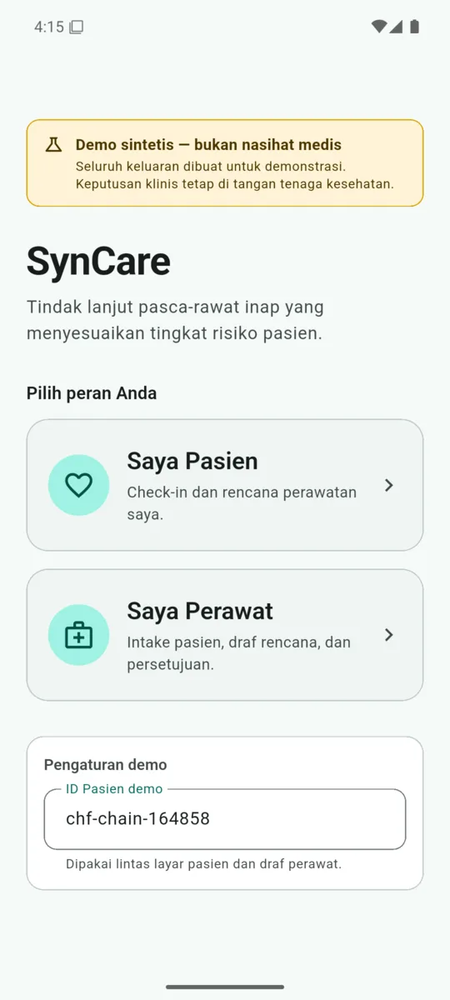
  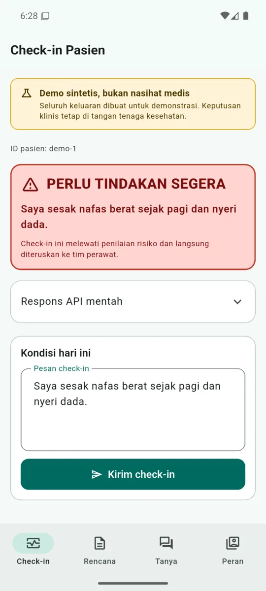
</p>

## Stack

| Concern | Choice |
|---|---|
| UI | Flutter 3.44 / Dart 3.12, Material 3 |
| State | `flutter_riverpod` 2.6 |
| Routing | `go_router` 17 |
| REST | `dio` with a bearer interceptor |
| SSE | `http.Client().send()` + a chunk-safe frame parser (never `EventSource`) |
| Secret | compiled `--dart-define` token or `flutter_secure_storage`; `shared_preferences` for non-sensitive state |

## Screens

### Patient

**Check-in** (`POST /api/v1/checkins`) renders F2 verbatim. A red-flag response
(`action: escalate_immediately`) produces an unmistakable red card with the server's reason,
above everything else.

<p align="center"></p>

**My plan** (`GET /api/v1/plans/:patientId`) shows the approved plan, risk badge, care intensity,
follow-up date/hotline extracted from the ServiceRequest sentence, and the approval timestamp.
A `404` is an honest "belum ada rencana" empty state. `plan_json.status` stays
`DRAFT pending human approval` by design — approval is the row existing, never that string.

<p align="center">
  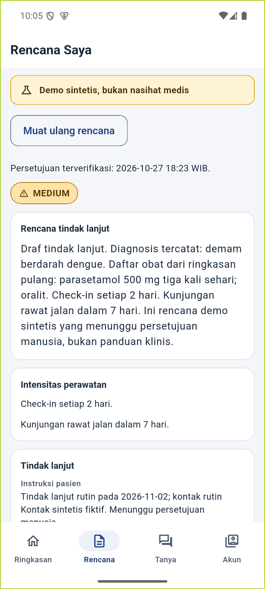
  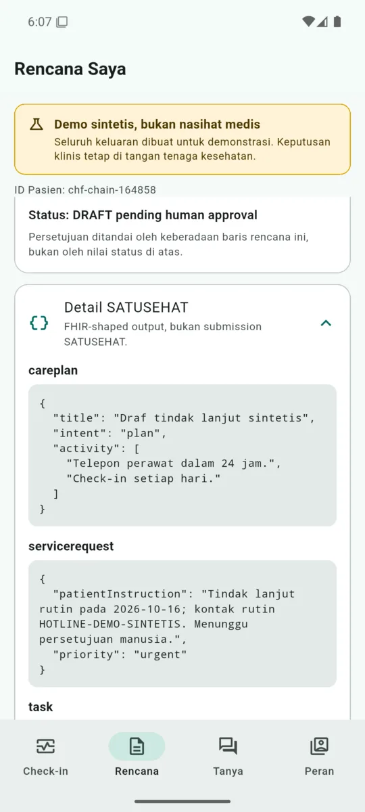
</p>

**Ask** (`POST /api/v1/answers`) shows the answer verbatim with its provenance chip. Refusals are
rendered as returned, not reworded.

<p align="center">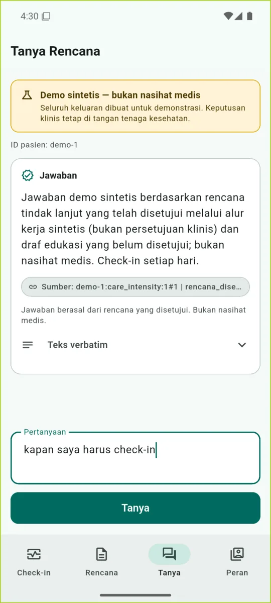</p>

### Nurse

**Intake** (`POST /api/v1/discharge`) renders tier, score, label, rationale, every risk factor
(value / threshold / points / met), missing fields, and the `not_clinically_validated` disclaimer.

<p align="center">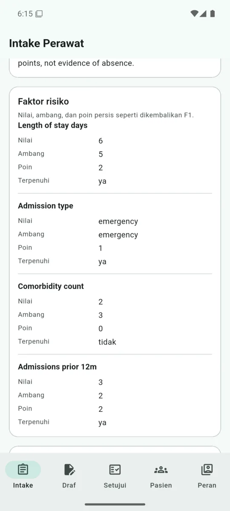</p>

**Draft** (`POST /api/v1/plans/draft`) requires an explicit follow-up date and hotline; F3 refuses
to invent either. The result is labelled as a draft with its honest status.

<p align="center">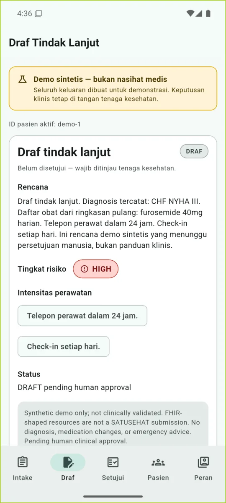</p>

**Approval desk** starts an F4 background job (`POST /api/v1/reviews`), consumes the SSE feed, and
renders the human gate with all four decisions. On resume it reopens the stream, so the terminal
output appears without a manual refresh. Timeout and stream failures show an honest fallback path.

<p align="center">
  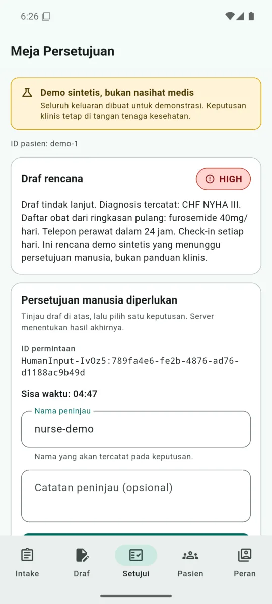
  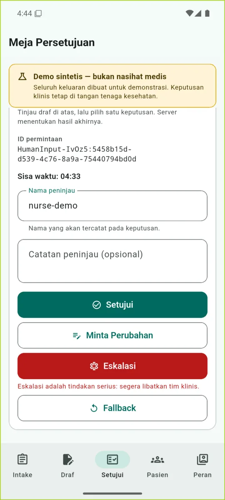
  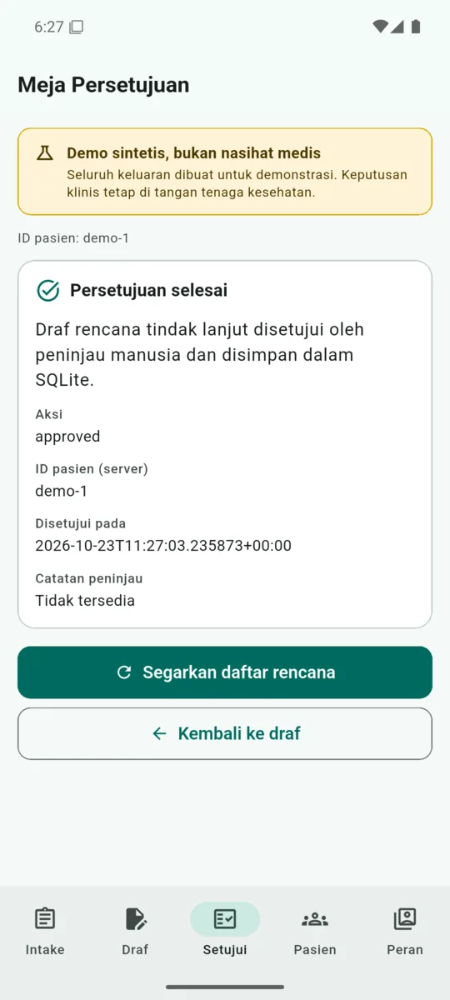
</p>

**Patients & audit** (`GET /api/v1/plans`) is read-only: approved rows plus the audit trail.

<p align="center">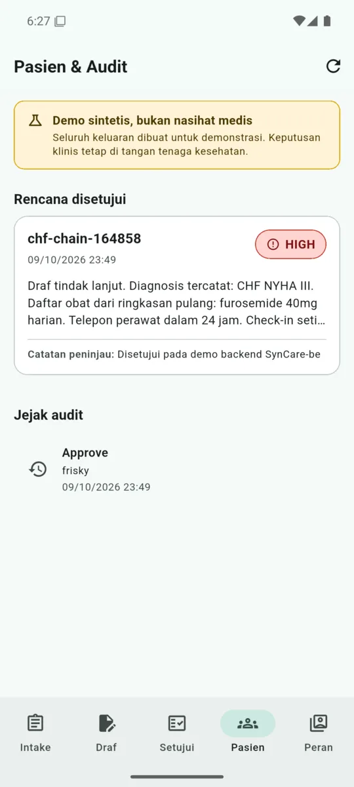</p>

## Running

Prerequisites: Flutter stable (3.44+), Android SDK with a phone emulator or an iOS simulator, and a
running SynCare backend (`http://127.0.0.1:8080` locally).

```bash
flutter pub get
flutter doctor -v
flutter analyze
flutter test
```

Android emulator (host loopback alias, no CORS needed):

```bash
flutter run -d emulator-5554 \
  --dart-define=API_BASE=http://10.0.2.2:8080 \
  --dart-define=API_TOKEN="<SYNCARE_API_KEY>" \
  --dart-define=PATIENT_ID=demo-1 \
  --dart-define=REVIEWER=nurse-demo
```

iOS simulator: `--dart-define=API_BASE=http://localhost:8080`.

| Define | Default | Purpose |
|---|---|---|
| `API_BASE` | `http://10.0.2.2:8080` | Backend base URL |
| `API_TOKEN` | empty | Bearer token; empty falls back to secure storage |
| `PATIENT_ID` | `demo-1` | Demo patient used by check-in/plan/ask and pre-filled in the draft |
| `REVIEWER` | `nurse-1` | Default actor on the approval desk |

The patient ID is also editable under **Pengaturan demo** on the role picker and persists locally.
On `401`, the error state offers a **Perbarui token** dialog; the token is written only to secure
storage. The token never goes into a query string or a committed file.

A browser/web build is not supported: the backend has no CORS allowlist, and the SSE feed needs the
authorization header. A physical device on the LAN needs CORS too, so it is reported rather than
worked around.

## API integration notes (verified against the live backend)

The live system overrides `FRONTEND-CONTRACT.md` where they differ. The client implements:

- **F4 start** takes the **complete F3 output JSON string** as `draft`; sending only `plan_text`
  fails the flow guard.
- **F4 resume to `SynCare-be` is flat**: `{request_id, action_id, actor, reviewer_note}`. The
  backend nests the decision for Langflow. `request_id` is always sent — omitting it returns `200`
  while leaving the job suspended.
- `GET /api/v1/plans/:patientId` returns `{patientId, plans: [...]}`; the client takes the first
  filtered row. `404` is an empty state.
- SSE frames are Langflow v2 frames: `data: {"event": "...", "data": {...}}` with no `event:` line.
  The parser also accepts standard `event:` + `data:` frames.
- Langflow closes the job stream when it pauses at the gate; after resume the desk reconnects to the
  same job id to receive `output`/`end`. Replayed gate frames are ignored once a decision was sent.
- F5 output is plain text, optionally ending with a `[...]` provenance block; it is not JSON.

### Local review-database caveat

On this workstation Langflow writes approvals to `/home/frxskie/langflow/syncare-review.sqlite3`,
while `SynCare-be` reads `data/langflow/langflow/syncare-review.sqlite3`. Consequently a freshly
approved plan appears in the approval desk's live result but not in **Patients & audit**, and F5
answers can exist for a patient whose plan row is absent (and vice versa). This is a backend
runtime configuration issue, not client logic. Align `SYNCARE_REVIEW_DB` (backend) with the
`db_path` used by the F4/F5 flow nodes, then restart both services. The client continues to show
each endpoint's honest response in the meantime.

## Tests

`flutter analyze` is clean and `flutter test` passes 128 tests. Coverage includes:

- Dio bearer header, `401` / `503` mapping, F2's JSON-string body, the flat resume payload, and the
  filtered `plans/:id` wrapper;
- SSE parsing for both frame styles, chunk boundaries, and gate normalization;
- one widget test per screen (render, disclaimer, loading, empty, error) plus the escalation branch;
- approval-desk waiting/gate/resume/output/timeout/error states, including stream resubscription
  after resume.

Tests are hermetic: `DioAdapter` for HTTP, fake `SyncareApi` and `ReviewEventSource` for screens.
No test hits the live backend.

## Scope and safety

- Synthetic demo only; not clinically validated; no diagnosis, medication changes, or emergency
  advice. FHIR-shaped output is **not** a SATUSEHAT submission.
- No Langflow API key exists in the Flutter source, assets, or binary. The app calls only the
  backend.
- Tier, score, red flags, drafts, and approvals come from the API verbatim; the client adds no
  clinical logic and no fabricated fallbacks.
- `--dart-define` values are visible in process listings on a shared machine; use secure storage for
  anything beyond a local demo, and never commit a real token.
